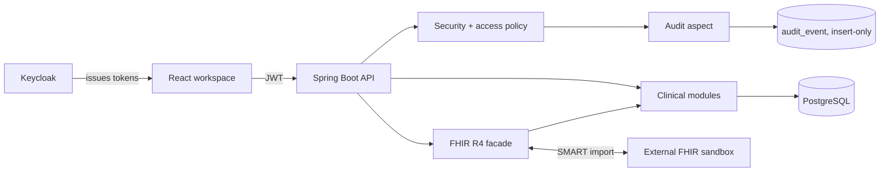

# EHR — Epic-Inspired EHR Spec

Sep 25, 2026 · @Teklu Mezgebo

## Overview and goals

Build a Java/Spring Boot EHR whose clinician UI mirrors Epic Hyperspace's patient workspace, backed by a FHIR R4 API, and ship it like production: containerized, tested, deployed, with a live demo.

Every resume bullet must be provable by something a reviewer can click, read in the repo, or see in a test.

| Resume claim | Proof in the project |
| --- | --- |
| Backend for a HIPAA-aligned platform processing FHIR R4 records and integrating with EHR systems | `/fhir/r4` endpoints (Patient, Encounter, Condition, Observation, MedicationRequest, AllergyIntolerance, Immunization) validated with HAPI FHIR; a SMART on FHIR import from a public sandbox (Epic or HAPI test server) |
| Append-only audit log on every PHI access | DB-level insert-only table (no UPDATE/DELETE grants, trigger guard), written by an AOP aspect on every protected route; integration tests assert a row per access |
| Role-based access control across clinical roles with care-team scoping | Physician and MA/nurse roles with a per-action permission matrix; care-team relationship checks; tests proving each role is denied outside its permissions |

Wording note: say "modeled on HIPAA Security Rule controls" rather than "HIPAA-compliant". Compliance is an organizational certification a portfolio project cannot hold, and interviewers in health tech notice.

## Epic-inspired UX

The screen is a three-zone workspace taken from the Hyperspace encounter view: a patient sidebar on the left, activity tabs across the top, and a section-navigated work area in the middle.

| Zone | Epic element | EHR version |
| --- | --- | --- |
| Top bar | Hyperspace toolbar (Chart, Encounter, Telephone, Refill, Patient Lists, In Basket) | Global nav + patient search (Ctrl+Space), open-patient tabs, logged-in user and role badge |
| Left sidebar (Storyboard) | Photo, name, age/sex/DOB, MRN, language, code status, allergies banner, PCP, coverage, care gaps count, problem list | Same fields; allergy count in a yellow banner; care-gap count in red; problem list grouped by department |
| Activity tabs | Chart Review, Synopsis, Rooming, Screenings, PlanWrap-up, Notes, MAR, Medications, Immunizations, Letters | Phase 1: Chart Review, Rooming, Notes, Medications. Later: Synopsis, PlanWrap-up, Immunizations |
| Rooming sub-nav | Reason for Visit, HM, Allergies, Medication Review, Vitals, History, SDOH, Rooming Notes | Section list that scrolls the work area; each section has Close / Previous / Next like Epic |
| Health Maintenance | Topics with status (Overdue, Never done, Next due, Aged out) | Rules engine computing due status from age, sex, problems (e.g. diabetes adds A1c every 6 months) |
| Footer actions | Add Order, Add Dx, Level of Service, Print AVS, Sign Visit | Add Order, Add Dx, Sign Visit (locks the encounter and note) |

Visual cues worth copying: red overdue icons, the encounter header ("9/2/2026 visit with Dr. X for Office Visit - Diabetes Follow Up"), and recent-visits tables inside a section. Use your own name, colors, and logo; mimic layout and workflow, not Epic's branding or proprietary assets.

## Tech stack

Java 21 + Spring Boot 4 on the backend, React/TypeScript on the frontend, PostgreSQL for storage, and Docker/Terraform for production. The hosting provider is decided near the end of the project (likely AWS).

| Layer | Choice | Why |
| --- | --- | --- |
| Language / framework | Java 21, Spring Boot 4.x, Gradle (Kotlin DSL) | Records, virtual threads; the stack hospital and payer backends actually run |
| FHIR | HAPI FHIR (structures-r4, validation) | Industry-standard Java FHIR library; parse, serialize, validate R4 resources |
| Security | Spring Security, OAuth2 Resource Server, JWT (Keycloak as IdP) | Real OIDC flow, roles as claims, SMART on FHIR scopes later |
| Persistence | PostgreSQL 16, Spring Data JPA, Flyway migrations | Versioned schema; JSONB column for raw FHIR resources |
| Frontend | React + TypeScript + Vite + Tailwind, TanStack Query | Reuses your existing MedChart frontend skills |
| Testing | JUnit 5, Mockito, Testcontainers, REST Assured, Playwright | Unit, real-DB integration, API, and end-to-end UI tests |
| Observability | Spring Actuator, Micrometer, structured JSON logs | Health checks for ECS, metrics for a demo dashboard |
| Infra | Docker, docker-compose, GitHub Actions, GitHub Container Registry, Terraform, Caddy; cloud provider TBD (likely AWS) | Hosting that shows infrastructure-as-code, CI/CD, and TLS |
| Docs | springdoc-openapi (Swagger UI) | Clickable API for reviewers |

An AI chart summary (Synopsis tab) is an optional Phase 3 feature; the Claude API is pay-per-use, so keep it behind a feature flag and off by default.

## Architecture and data model

Start as a modular monolith: one Spring Boot app split into packages by clinical domain, so it deploys simply but reads like services.

Modules (Java packages): `patient`, `encounter`, `clinical` (problems, allergies, meds, vitals), `notes`, `healthmaintenance`, `access` (roles, care team), `audit`, `fhir` (mapping + endpoints), `integration` (external FHIR import).

| Table | Key columns | FHIR mapping |
| --- | --- | --- |
| patient | id, mrn, name, dob, sex, language, code\_status, photo\_url, pcp\_id | Patient |
| encounter | id, patient\_id, provider\_id, dept, type, reason, status (open/signed), start\_at | Encounter |
| problem | id, patient\_id, icd10, description, onset, status | Condition |
| allergy | id, patient\_id, substance, reaction, severity | AllergyIntolerance |
| medication\_order | id, patient\_id, rxnorm, sig, status, prescriber\_id | MedicationRequest |
| observation | id, patient\_id, encounter\_id, category, loinc, display, panel, value, unit, ref\_low, ref\_high, taken\_at | Observation (labs, vitals) |
| immunization | id, patient\_id, cvx, given\_on | Immunization |
| note | id, encounter\_id, author\_id, type (PROGRESS or ROOMING), subjective, objective, assessment, plan, version, signed\_at | DocumentReference |
| hm\_topic / hm\_status | rule definition; per-patient due/overdue/done | derived |
| app\_user / care\_team\_member | user, role, dept; patient-provider relationship | Practitioner, CareTeam |
| audit\_event | id, user\_id, action, resource\_type, resource\_id, patient\_id, ip, at, prev\_hash | AuditEvent |

Use coded vocabularies (ICD-10, LOINC, RxNorm, CVX) from small seeded subsets rather than full licensed sets.

## Security and compliance

Access is decided by role plus relationship: a user may perform an action only if their role grants it and they are on the patient's active care team. Two roles keep the matrix small: PHYSICIAN (Epic provider) and MA\_NURSE (Epic MA security class).

| Permission | PHYSICIAN | MA\_NURSE |
| --- | --- | --- |
| Read chart (Storyboard, Chart Review, results) | Yes | Yes |
| Room a visit: reason for visit, vitals, allergies, medication review, HM updates | Yes | Yes |
| Write, edit, and sign their own visit note (progress note for physicians, rooming note for MA/nurse) | Yes | Yes |
| Sign an encounter (Sign Visit, once every note is signed) | Yes | Yes |
| Place orders and add diagnoses | Yes | No |

Every permission is checked per patient against the care team; a role alone never grants access.

**Audit log.** A Spring AOP aspect on an `@PhiAccess` annotation writes an `audit_event` row for every read and write of PHI, including denied attempts. Opening a chart is one request and one audit row: `GET /api/patients/{id}` returns the Storyboard and SnapShot (demographics, problems, allergies, latest result per lab) together, and those sections have no endpoints of their own. Activities opened later (notes, encounters, results) load on demand and are audited as their own accesses, like Epic's access log. The app's DB user has INSERT and SELECT only on that table; a trigger rejects UPDATE/DELETE. Each row stores the hash of the previous row, so tampering is detectable by a verify endpoint.

**PHI handling controls modeled on the HIPAA Security Rule:** TLS everywhere (Caddy + Let's Encrypt), encrypted block volume, secrets in GitHub Actions secrets and a root-only env file on the VM, 15-minute session timeout, no PHI in application logs, minimum-necessary access per permission. Use only synthetic patients (Synthea generates realistic FHIR bundles).

## Feature backlog by phase

Phase 1 is the demoable core: an MA can room a diabetes follow-up and a physician can sign it, with every access audited.

**Phase 1 — Core chart**

- [ ] Login via Keycloak; roles in JWT; patient search and open-patient tabs
- [ ] Storyboard sidebar: demographics, MRN, allergies banner, PCP, problem list, care-gap count
- [ ] Encounter creation and header ("visit with … for Office Visit – reason")
- [ ] Rooming: Reason for Visit, Vitals (BP, HR, temp, weight, BMI auto-calc), Allergies, Medication Review
- [ ] SOAP note editor; Sign Visit locks encounter and note
- [ ] Audit aspect on all PHI routes + insert-only table + per-patient access log view
- [ ] Care-team relationship check on every chart read

**Phase 2 — Epic depth**

- [ ] Health Maintenance engine with Overdue / Never done / Next due / Aged out, driven by problems (diabetes → A1c, foot exam, eye exam)
- [ ] Chart Review tab: encounters, labs, notes, filterable tables
- [ ] Results trending (A1c, BP) as a line chart
- [ ] Orders + Dx: Add Order (lab, med, immunization) and Add Dx with ICD-10 search
- [ ] In Basket: results to review, unsigned notes

**Phase 3 — Interoperability and polish**

- [ ] FHIR R4 read/search endpoints + CapabilityStatement at `/fhir/r4/metadata`
- [ ] SMART on FHIR import of a patient from a public sandbox; Synthea bulk seed
- [ ] Synopsis tab with Claude-generated chart summary (synthetic data only)
- [ ] After Visit Summary PDF
- [ ] Clinical decision support alert (e.g. A1c > 9 with no med change)

## Testing, containers, CI/CD, deployment, demo

The production story is: every push runs tests against a real Postgres, builds a multi-arch image, and deploys to a cloud host provisioned by Terraform, with automatic HTTPS.

| Area | Plan | Target |
| --- | --- | --- |
| Unit tests | JUnit 5 + Mockito on services, HM rules, access policy | ≥ 80% line coverage on `access`, `audit`, `healthmaintenance` (JaCoCo gate) |
| Integration tests | Testcontainers Postgres + Keycloak; REST Assured per endpoint | Every protected route has an "allowed", "denied", and "audited" test |
| FHIR tests | HAPI validator on every outbound resource | Zero validation errors |
| E2E | Playwright: MA rooms visit → physician signs → MA is denied signing | Runs in CI on the docker-compose stack |
| Security scans | OWASP Dependency-Check, Trivy image scan, CodeQL (all free for public repos) | No high/critical findings |
| Containers | Multi-stage Dockerfile (Gradle build → distroless JRE 21), non-root user, built for amd64 + arm64 with Docker Buildx; `docker-compose.yml` with api, web, postgres, keycloak, caddy | `docker compose up` gives a working demo locally and in the cloud |
| CI/CD | GitHub Actions: test → build → push to GitHub Container Registry → SSH deploy (`docker compose pull && up -d`) with a health-check gate | Deploy on merge to `main` |
| Hosting | Decided near the end of the project (likely AWS); provisioned with Terraform | TBD |
| Domain + TLS | Free subdomain (DuckDNS) or `sslip.io`; Caddy gets Let's Encrypt certs automatically | HTTPS demo URL |
| Demo | Seeded Synthea patients, one-click demo logins per role, 2-minute Loom walkthrough, README with architecture diagram and screenshots | Linked from resume and GitHub |

Fallback if hosting is unavailable: keep the full stack runnable with `docker compose up` and demo from a recording. The Terraform and CI pipeline still show the production skills.

## Where to start

Start with the audit log and access policy, not the UI: they are the hardest to retrofit and they carry two of your three bullets.

1. Generate the project at start.spring.io: Java 21, Gradle, Web, Security, OAuth2 Resource Server, Data JPA, Flyway, PostgreSQL, Validation, Actuator. Add HAPI FHIR and Testcontainers.
2. Write `docker-compose.yml` with Postgres and Keycloak; create a realm with the PHYSICIAN and MA\_NURSE roles and one demo user each.
3. Flyway `V1__core.sql`: patient, app\_user, care\_team\_member, encounter, audit\_event (plus the no-update/no-delete trigger and grants).
4. Build `GET /api/patients/{id}` guarded by an `AccessPolicy` bean (role + care-team check) and annotated `@PhiAccess`.
5. Implement the audit aspect; write three Testcontainers tests: care-team physician allowed, other physician denied, both produce audit rows.
6. Add GitHub Actions running `./gradlew test` on every push.
7. Only then scaffold the React Storyboard sidebar reading that endpoint.

The first milestone is one vertical slice: login → open a patient → see the sidebar → audited, tested, in CI.

## Open questions

Decided: this is a separate new project, not a MedChart rewrite; no fixed timeline, so phases are ordered but undated; hosting uses free options only; the frontend stays React/TypeScript; caretaker access is out of scope, and roles are limited to physician and MA/nurse; front desk, patient portal, admin, and break-the-glass are deferred.

- [x] Is this a Java rewrite of the existing Node/TypeScript MedChart (reusing its React frontend), or a separate second project?
- [x] Frontend: keep React/TypeScript, or go server-rendered (Thymeleaf/Vaadin) to stay all-Java?
- [x] Who is the "caretaker": a family proxy (MyChart-style) or a clinical caregiver such as a home-health aide? It changes the scopes.
- [x] Timeline: is there a target date (e.g. before spring 2027 applications)?
- [x] Budget for AWS: always-on demo, or spin up on demand with Terraform?
